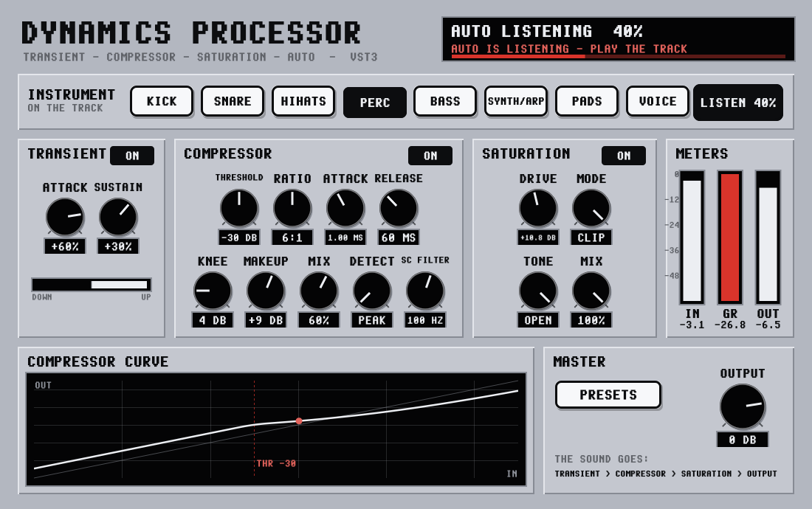

# Dynamics Processor

**A free combi effect: transient shaper, compressor and saturation in one, with AUTO. Tell it which instrument is on
the track, play the track, click AUTO, and it fixes the beat by setting all three for that sound. Every knob can
still be turned by hand afterwards. VST3 for Windows (64-bit and 32-bit), VST3 and Audio Unit for Mac.** From the
maker of [Four Tracker](https://elcrispo76.github.io/Four-Tracker/), in the same look as the Breakbeat Processor and
the FX Processors.

The sound goes **TRANSIENT → COMPRESSOR → SATURATION → OUTPUT**. Each part has its own **ON / OFF** button.

## How to use it

1. **INSTRUMENT:** click what is on the track: **KICK, SNARE, HIHATS, PERC, BASS, SYNTH/ARP, PADS** or **VOICE**.
   This sets every knob to a starting point for that instrument and switches all three parts on (see the table).
2. **AUTO:** play the track and click AUTO. It listens to 4 seconds of sound (silence doesn't count) and the screen
   shows how far it is. Then it sets:
   - **TRANSIENT ATTACK and SUSTAIN:** a beat that is already squashed (little difference between the hits and the
     rest) gets more punch, a very spiky one less, and fast hits get a shorter tail so they don't run into each other.
   - **COMPRESSOR THRESHOLD**, so the loud parts are squeezed by the amount that suits the instrument (it takes the
     transient shaper in front of it into account), **RELEASE** (shorter when the hits come fast) and **MAKEUP**
     (the same loudness as before, peaks under -1 dB).
   - **SATURATION DRIVE:** less on a sound that is already dense.

   Click AUTO again while it listens to stop it. The screen says what AUTO set.
3. **By hand:** turn anything you like afterwards, or switch a part off. The curve shows what the compressor does
   (the red dot is where the sound is now), the bar under TRANSIENT shows how much it turns the sound up or down, and
   the meters show the level in, the gain reduction (**GR**) and the level out.

| Instrument | Transient (attack / sustain) | Compressor | Saturation |
|---|---|---|---|
| **KICK** | +30 / -10 | 4:1, 15 ms attack (the click goes through), 80 ms, PEAK, squeezes 6 dB | TAPE, drive 25 |
| **SNARE** | +40 / +10 | 4:1, 5 ms, 120 ms, SC 100 Hz, 5 dB | TUBE, drive 20 |
| **HIHATS** | +15 / -25 | 3:1, 1 ms, 50 ms, SC 250 Hz, 3 dB | TAPE, drive 10 |
| **PERC** | +30 / -15 | 4:1, 3 ms, 90 ms, SC 100 Hz, 4 dB | TAPE, drive 15 |
| **BASS** | +10 / +10 | 4:1, 10 ms, 150 ms, RMS, 5 dB | TUBE, drive 35 |
| **SYNTH/ARP** | +15 / 0 | 3:1, 5 ms, 100 ms, SC 80 Hz, 4 dB | TAPE, drive 20 |
| **PADS** | -20 / +20 | 2:1, 30 ms, 400 ms, RMS, 3 dB | TAPE, drive 15 |
| **VOICE** | 0 / 0 | 3:1, 5 ms, 200 ms, RMS, SC 100 Hz, 6 dB | TUBE, drive 20 |

## The parts

| Part | Knobs |
|---|---|
| **TRANSIENT** | **ATTACK** -100 to +100 %: turns the hits (the first milliseconds of every note or drum) up or down. **SUSTAIN** -100 to +100 %: turns the tail after each hit up (more body and room) or down (tighter). It changes the shape of the sound, not its level: a steady tone goes through as it is |
| **COMPRESSOR** | **THRESHOLD** (-60 to 0 dB), **RATIO** (1.5:1 to 20:1 and LIMIT), **ATTACK** (0.05 - 100 ms), **RELEASE** (10 ms - 2 s), **KNEE** (0 - 24 dB), **MAKEUP** (-12 to +24 dB), **MIX** (under 100 % = parallel compression), **DETECT** (PEAK or RMS), **SC FILTER** (the compressor doesn't listen to the bass below 40 - 400 Hz). Left and right together |
| **SATURATION** | **DRIVE** (0 to +24 dB into the curve), **MODE** (**TAPE** round and smooth, **TUBE** warm and uneven, **CLIP** harder and brighter), **TONE** (softens the top, 2 - 20 kHz, OPEN = off), **MIX**. 2 x oversampled so it doesn't sound digital. The level is kept: the loudness going in is measured and the result is set to the same, so DRIVE changes the sound, not the volume |
| **MASTER** | **PRESETS** (15: KICK PUNCH, SNARE CRACK, BASS GROWL, BREAK SMASH, DRUM BUS GLUE, SNAP ONLY, TAPE WARMTH, LO-FI CRUNCH, BRICKWALL LIMIT ..., also the plugin's programs), **OUTPUT** (-24 to +6 dB, nothing ever goes over full scale) |

Turn a knob by dragging up or down (Shift = fine), the mouse wheel, or double-click for the default. Two-way knobs
(DETECT) switch with a click. Every knob can be automated, and everything is saved with the song. The oversampling
gives a latency of 3 samples, which the plugin tells the host. In Four Tracker, load it on a channel's FX slot or on
the MASTER (FX / F8, SCAN).

## Install

- **Windows:** run `DynamicsProcessor-Setup-1.0.0.exe`. It asks where to put the VST3 (standard: `C:\Program Files\Common Files\VST3`).
  Rescan the plugins in your DAW (in Four Tracker: FX, SCAN). Windows may say "Windows protected your PC" because the
  installer isn't signed: click **More info**, then **Run anyway**.
- **Mac:** open the .dmg and copy `Dynamics Processor.vst3` to `/Library/Audio/Plug-Ins/VST3` and/or
  `Dynamics Processor.component` to `/Library/Audio/Plug-Ins/Components`.

## Building

- **Windows:** Visual Studio 2022 or 2026 with "Desktop development with C++". Put JUCE 8.0.10 as a folder `JUCE`
  here or one folder up, then run `build-windows.bat`: it builds 64-bit and 32-bit into `dist`. `build-installer.bat`
  (Inno Setup 6.3+) makes `dist\DynamicsProcessor-Setup-1.0.0.exe`.
- **VST2, for your own use only:** put the VST2 SDK anywhere under `SDKs` and run `build-windows-vst2.bat`
  (`dist-vst2\32-bit\Dynamics Processor.dll` for 32-bit hosts like MadTracker). Never share a VST2 build: the VST2
  SDK licence does not allow new VST2 plugins to be distributed. The installer is VST3 only.
- **Mac:** `bash build-mac.sh` → `dist-mac/DynamicsProcessor-1.0.0-mac.dmg`.
- **Tests (Linux):** `cmake -S . -B build -DDYNPROC_TESTS=ON && cmake --build build`, then run `DynTests`.

| Path | Contents |
|---|---|
| `Source/DynEngine.h` | The sound: transient shaper, compressor, saturation, meters, and the AUTO analysis |
| `Source/PluginProcessor.*` | Parameters, instruments, AUTO, presets, saving |
| `Source/PluginEditor.*`, `Source/PixelUI.h` | The window: knobs, buttons, curve and meters |
| `Source/PixelFont.h` | The Amiga-style pixel font from Four Tracker |
| `Tests/DynTests.cpp` | Automated tests |

## Licence

GNU AGPLv3 or later, like Four Tracker. Built with [JUCE](https://juce.com) 8 (AGPLv3) and the Steinberg VST3 SDK (MIT).
VST is a registered trademark of Steinberg Media Technologies GmbH.
