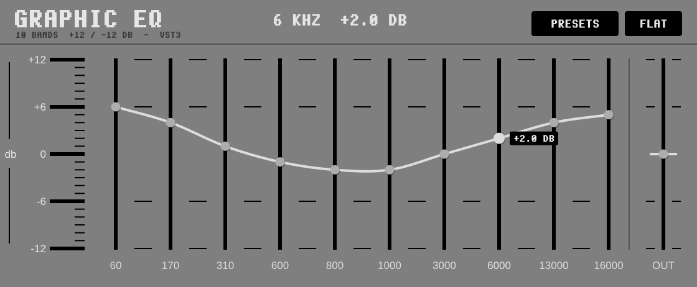

# Graphic EQ

**A free 10 band graphic equalizer: drag the small round knobs up to +12 dB or down to -12 dB, and the white line
draws the curve through them. What you see is what you hear. VST3 for Windows (64-bit and 32-bit), VST3 and Audio
Unit for Mac.** From the maker of [Four Tracker](https://elcrispo76.github.io/Four-Tracker/).

## How to use it

- **Bands:** 60, 170, 310, 600, 800, 1000, 3000, 6000, 13000 and 16000 Hz, each +12 to -12 dB.
- **Click** on a bar and the knob jumps there. **Drag** up and down, or **drag sideways** to draw a curve over
  several bars at once. **Shift** + drag is fine adjustment, the **mouse wheel** moves 0.5 dB, and a
  **double-click** puts a band back at 0. While the mouse is on a bar, its frequency and value are shown.
- **OUT** (the bar on the right): the output level, +12 to -12 dB, to make up for a boost or a cut.
- **PRESETS:** 14 curves (BASS BOOST, SMILE (LOUDNESS), MID SCOOP, VOCAL PRESENCE, AIR, WARM, KICK THUMP, SNARE SNAP,
  HIHAT SHINE, BASS LINE, TELEPHONE, LO-FI, CLEAR MUD ...), also the plugin's programs. **FLAT** puts every band at 0.

### What you see is what you hear

On most graphic EQs, neighbouring bands add up: with 600, 800 and 1000 Hz all at +6 dB you really get about +10 dB
at 800 Hz, and the sound doesn't follow the knobs. This EQ works out how much each filter must really do, so the
sound at every band's frequency is exactly what its knob says (within a few hundredths of a dB). Between the bands
the sound follows the smooth curve.

- Moving a knob glides (about 20 ms), so it never clicks, even when automated.
- With every knob at 0 the sound passes through untouched. There is no latency.
- Every band can be automated, and everything is saved with the song. In Four Tracker, load it on a channel's FX slot
  or on the MASTER (FX / F8, SCAN).

## Install

- **Windows:** run `GraphicEq-Setup-1.0.0.exe`. It asks where to put the VST3 (standard: `C:\Program Files\Common Files\VST3`).
  Rescan the plugins in your DAW (in Four Tracker: FX, SCAN). Windows may say "Windows protected your PC" because the
  installer isn't signed: click **More info**, then **Run anyway**.
- **Mac:** open the .dmg and copy `Graphic EQ.vst3` to `/Library/Audio/Plug-Ins/VST3` and/or
  `Graphic EQ.component` to `/Library/Audio/Plug-Ins/Components`.

## Building

- **Windows:** Visual Studio 2022 or 2026 with "Desktop development with C++". Put JUCE 8.0.10 as a folder `JUCE`
  here or one folder up, then run `build-windows.bat`: it builds 64-bit and 32-bit into `dist`. `build-installer.bat`
  (Inno Setup 6.3+) makes `dist\GraphicEq-Setup-1.0.0.exe`.
- **VST2, for your own use only:** put the VST2 SDK anywhere under `SDKs` and run `build-windows-vst2.bat`
  (`dist-vst2\32-bit\Graphic EQ.dll` for 32-bit hosts like MadTracker). Never share a VST2 build: the VST2 SDK
  licence does not allow new VST2 plugins to be distributed. The installer is VST3 only.
- **Mac:** `bash build-mac.sh` → `dist-mac/GraphicEq-1.0.0-mac.dmg`.
- **Tests (Linux):** `cmake -S . -B build -DGEQ_TESTS=ON && cmake --build build`, then run `GeqTests`.

| Path | Contents |
|---|---|
| `Source/EqEngine.h` | The sound: the 10 filters, the correction so the sound follows the knobs, the glide |
| `Source/PluginProcessor.*` | Parameters, presets, saving |
| `Source/PluginEditor.*` | The window: ruler, bars, knobs and the curve |
| `Source/PixelFont.h` | The Amiga-style pixel font from Four Tracker |
| `Tests/GeqTests.cpp` | Automated tests |

## Licence

GNU AGPLv3 or later, like Four Tracker. Built with [JUCE](https://juce.com) 8 (AGPLv3) and the Steinberg VST3 SDK (MIT).
VST is a registered trademark of Steinberg Media Technologies GmbH.
